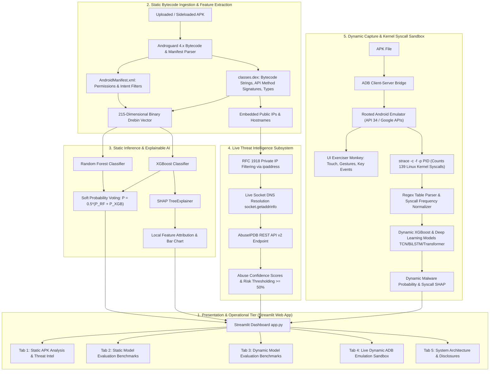
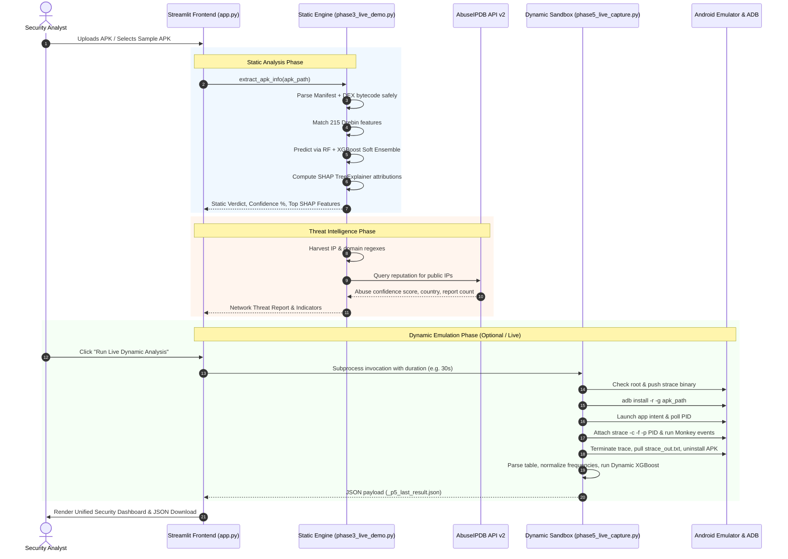
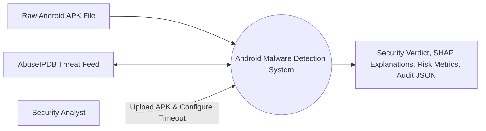
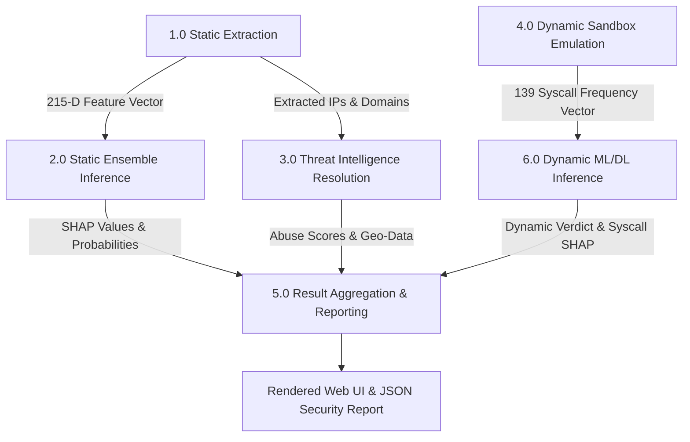

# Android Malware Detection System: Architecture, Design Flow & Technical Specifications

**Project Title:** AI-Based Detection of Malicious Sideloaded Android Applications Using Runtime Threat Intelligence and Dynamic Emulation  
**Document Version:** 2.0 (Production & Academic Specification)  
**Target Environment:** Cross-Platform (Windows 11 / WSL 2 Ubuntu / Android Virtual Device)  

---

## Executive Summary

Sideloaded Android applications—installed outside curated repositories like Google Play—bypass pre-deployment vetting, exposing users to sophisticated adware, spyware, banking Trojans, and root exploits. Modern Android malware frequently leverages runtime obfuscation, dynamic payload loading, and anti-analysis evasion tactics that defeat naive static signature scanners.

This project delivers an end-to-end, multi-stage defense-in-depth framework featuring:
1. **Static Analysis Engine (Drebin-215)**: Safe APK bytecode decompilation extracting 215 permissions, intents, API call signatures, and sensitive shell commands.
2. **Machine Learning Classifiers & Ensemble**: Random Forest and XGBoost with soft probability voting achieving **98.14% accuracy** on held-out static test benchmarks.
3. **Local Explainable AI (SHAP)**: TreeExplainer-driven local feature attribution identifying exact structural indicators driving each classification verdict.
4. **Automated Threat Intelligence Enrichment**: Extraction of embedded public IP addresses and domain hostnames cross-referenced in real-time against the AbuseIPDB REST API v2.
5. **Dynamic Sandbox Emulation (CICMalDroid2020 & strace)**: Live capture of Linux kernel system calls on a rooted Android emulator with UI monkey event fuzzing, evaluated against deep learning models (TCN, BiLSTM, Transformer) and XGBoost.
6. **Interactive Streamlit Web Dashboard**: Production-grade operational console providing single-click APK triage, live ADB diagnostic verification, SHAP risk visualization, and downloadable JSON security audit reports.

---

## 1. System Architecture

The system implements a decoupled, five-tier architecture ensuring isolation, fault tolerance, and modular scalability.

---

## 2. Design Flow & Lifecycle

The end-to-end execution lifecycle follows a sequential state transition pipeline:

---

## 3. Data Flow Architecture (DFD)

### DFD Level 0: Context Diagram

### DFD Level 1: Subsystem Data Flow

---

## 4. Machine Learning & Deep Learning Algorithms

### 4.1 Static Analysis Pipeline (Drebin-215)
- **Dataset:** Drebin-215 benchmark comprising 15,036 total application feature vectors (5,560 Malware, 9,476 Benign) deduplicated to 7,254 unique samples.
- **Feature Space:** 215 binary indicators across 4 domains:
  1. *Permissions* (e.g., `SEND_SMS`, `READ_PHONE_STATE`, `ACCESS_FINE_LOCATION`)
  2. *Intents/Action Filters* (e.g., `BOOT_COMPLETED`, `PACKAGE_REPLACED`)
  3. *Sensitive API Calls* (e.g., `getDeviceId`, `sendTextMessage`, `DexClassLoader`)
  4. *Shell & Root Commands* (e.g., `chmod`, `mount`, `chown`, `/system/bin`)
- **Classifiers Used:**
  - **Random Forest:** Ensemble of 100 de-correlated decision trees with Gini impurity splitting.
  - **XGBoost:** Extreme Gradient Boosted decision trees with shrinkage (`learning_rate=0.1`), max depth 6, and log-loss objective.
  - **Soft Voting Ensemble:** Fused prediction computing the arithmetic mean of calibrated probabilities:
    $$P_{	ext{ensemble}}(	ext{Malware} \mid x) = rac{1}{2} \left[ P_{	ext{RF}}(	ext{Malware} \mid x) + P_{	ext{XGB}}(	ext{Malware} \mid x) 
ight]$$

### 4.2 Dynamic Analysis Pipeline (CICMalDroid2020)
- **Dataset:** CICMalDroid2020 dynamic behavioral dataset with 11,520 applications traced during runtime execution.
- **Feature Space:** 139 Linux kernel system call frequency counts normalized to capture process execution behavior.
- **Model Architectures Benchmarked:**
  1. **XGBoost Classifier:** Tree-boosted model achieving superior tabular discrimination on syscall frequency vectors.
  2. **Multi-Branch Temporal Convolutional Network (TCN):** Dilated causal 1D convolutions with residual skip connections and receptive field expansion for sequence dynamics.
  3. **Bidirectional LSTM (BiLSTM):** Recurrent neural network capturing forward and backward temporal dependencies across execution steps.
  4. **Transformer:** Multi-head self-attention encoder modeling non-local syscall interaction dependencies.

### 4.3 Validation Strategy & Rigor
- **Cluster-Held-Out Cross-Validation:** To prevent artificial performance inflation caused by family-level data leakage (where variants of the same malware family exist in both train and test splits), samples were clustered by behavioral family and entire clusters were held out during evaluation.
- **McNemar Statistical Significance Tests:** Pairwise contingency table tests with Bonferroni correction confirming whether accuracy differences between deep learning architectures and XGBoost are statistically significant ($p < 0.05$).

---

## 5. Threat Intelligence Subsystem

The runtime threat intelligence pipeline bridges static code inspection with active perimeter defense:

1. **Bytecode Mining:** Scans string pools across all compiled `classes.dex` files using high-precision IPv4 and RFC-compliant domain regular expressions:
   - IPv4 regex: `(?:\d{1,3}\.){3}\d{1,3}`
   - Domain regex: `(?:[a-zA-Z0-9-]+\.)+[a-zA-Z]{2,}`
2. **RFC 1918 & Known Host Filtering:** Drops non-routable private addresses (`10.0.0.0/8`, `172.16.0.0/12`, `192.168.0.0/16`, `127.0.0.0/8`) and legitimate development namespaces (e.g., `schemas.android.com`, `googleapis.com`, `google.com`).
3. **Optional DNS Resolution:** Resolves embedded hostnames to public IPv4 targets using `socket.getaddrinfo`.
4. **AbuseIPDB Integration:** Queries the AbuseIPDB v2 endpoint (`https://api.abuseipdb.com/api/v2/check`) with 90-day historical window. Captures:
   - Abuse Confidence Score (0% to 100%)
   - Total abuse report counts and reporting country
   - ISP / Usage type classification
5. **Threat Scoring:** Any IP with $\ge 50\%$ confidence is flagged as an active Malicious Command-and-Control (C2) / exfiltration endpoint.

---

## 6. Explainable AI (XAI) Framework

To satisfy regulatory and security auditing standards, every prediction is paired with local feature explanations via **SHAP (SHapley Additive exPlanations)** based on cooperative game theory:

$$\phi_i(x) = \sum_{S \subseteq F \setminus \{i\}} rac{|S|! (|F| - |S| - 1)!}{|F|!} \left[ f_x(S \cup \{i\}) - f_x(S) 
ight]$$

- **TreeExplainer:** Evaluates feature contributions in polynomial time $O(TLD^2)$ rather than exponential sampling time.
- **Local Attribution:** Highlights top features increasing malware probability (red/warning) versus features establishing benign profile (blue/green).
- **Global Interpretability:** Summary beeswarm plots and mean absolute SHAP bar charts reveal global feature importance rankings across the entire training corpus.

---

## 7. Experimental Results & Performance Benchmarks

### 7.1 Static Analysis Evaluation (Drebin-215 Test Split)
Evaluated on a 20% held-out test set ($N = 1,451$ unique applications):

| Model Architecture | Accuracy | Precision | Recall (Malware) | F1-Score | ROC-AUC |
| :--- | :---: | :---: | :---: | :---: | :---: |
| **Random Forest** | 97.11% | 96.02% | 91.55% | 0.9373 | 0.9926 |
| **XGBoost** | 98.00% | 95.91% | **95.63%** | 0.9577 | **0.9961** |
| **Soft Voting Ensemble (RF + XGB)** | **98.14%** | **96.75%** | 95.34% | **0.9604** | 0.9952 |

5-Fold Stratified Cross-Validation confirms model stability:
- **Random Forest:** $97.20\% \pm 0.22\%$ accuracy, ROC-AUC $0.9930 \pm 0.0012$
- **XGBoost:** $97.63\% \pm 0.36\%$ accuracy, ROC-AUC $0.9952 \pm 0.0017$
- **Fused Ensemble:** $97.63\% \pm 0.33\%$ accuracy, ROC-AUC $0.9948 \pm 0.0012$

### 7.2 Dynamic System-Call Evaluation (CICMalDroid2020)
Evaluated on 11,520 applications across 139 system calls:

#### Standard Random Split (80/20):
| Model | Test Accuracy | Precision | Recall | Specificity | F1-Score | ROC-AUC |
| :--- | :---: | :---: | :---: | :---: | :---: | :---: |
| **XGBoost** | **97.31%** | **99.01%** | **97.79%** | **94.69%** | **0.9840** | **0.9915** |
| **TCN (Multi-Branch)** | 94.53% | 96.33% | 97.23% | 79.89% | 0.9678 | 0.9554 |
| **Transformer** | 90.93% | 97.96% | 91.16% | 89.66% | 0.9444 | 0.9691 |
| **BiLSTM** | 90.80% | 97.33% | 91.62% | 86.31% | 0.9439 | 0.9523 |

#### Cluster-Held-Out Cross-Validation (Conservative / Zero-Leakage):
| Model | Accuracy | Precision | Recall | Specificity | F1-Score | ROC-AUC |
| :--- | :---: | :---: | :---: | :---: | :---: | :---: |
| **XGBoost** | **91.99% ± 3.36%** | **97.48% ± 1.49%** | **92.98% ± 4.12%** | **87.49% ± 5.13%** | **0.9513** | **0.9600** |
| **Transformer** | 86.15% ± 6.62% | 96.99% ± 1.61% | 86.32% ± 8.64% | 85.60% ± 6.13% | 0.9112 | 0.9419 |
| **TCN (Multi-Branch)** | 84.99% ± 3.14% | 96.33% ± 2.19% | 85.54% ± 3.89% | 82.74% ± 9.29% | 0.9056 | 0.9013 |
| **BiLSTM** | 79.69% ± 9.25% | 95.56% ± 1.72% | 79.74% ± 11.40% | 79.31% ± 8.74% | 0.8657 | 0.8806 |

### 7.3 McNemar Statistical Significance Matrix
Pairwise McNemar hypothesis tests on cluster-held-out predictions confirm significant performance divergence:
- **TCN vs. BiLSTM:** $p = 0.0$ ($1481$ TCN-only correct vs $870$ BiLSTM-only correct) $
ightarrow$ **Significant**
- **TCN vs. Transformer:** $p = 0.0011$ ($758$ TCN-only correct vs $891$ Transformer-only correct) $
ightarrow$ **Significant**
- **TCN vs. XGBoost:** $p = 0.0$ ($587$ TCN-only correct vs $1393$ XGBoost-only correct) $
ightarrow$ **Significant**

---

## 8. Technical Specifications & Environment Stack

| Layer | Component | Version / Specification | Role |
| :--- | :--- | :--- | :--- |
| **Host OS** | Windows 11 64-bit | Build 22621+ | Primary developer workstation & Android Emulator host |
| **Runtime Subsystem** | WSL 2 (Ubuntu 24.04 LTS) | Linux Kernel 5.15+ | Isolated Linux environment running Python & Streamlit |
| **Programming Language** | Python | 3.12+ (x86_64) | Core backend pipeline, ML inference, and API clients |
| **Web Presentation** | Streamlit | 1.40.0+ | Modern reactive web user interface & charts |
| **Bytecode Analysis** | Androguard | 4.1.4+ | DEX decompiler, manifest extraction, string pool parser |
| **Machine Learning** | Scikit-learn & XGBoost | 1.6+ / 2.1+ | Random Forest & Gradient Boosted Tree models |
| **Deep Learning** | PyTorch | 2.5.0+ | Multi-Branch TCN, BiLSTM, and Transformer inference |
| **Explainable AI** | SHAP | 0.46.0+ | Shapley additive feature importance computation |
| **Device Bridge** | Android ADB | 35.0.2 (Windows exe via ~/bin/adb wrapper) | Bridge connecting WSL2 scripts to Windows Android Emulator |
| **Mobile Virtualization** | Android Studio Emulator | API 34 ("Google APIs" system image, rooted) | Dynamic execution sandbox with strace & monkey |
| **Threat Intelligence** | AbuseIPDB REST API v2 | HTTPS JSON API | Live IP reputation & C2 confidence scoring |

---

## 9. Input & Output Data Specifications

### 9.1 System Inputs
1. **APK File:** Valid Android installation package (.apk) uploaded via browser or CLI.
2. **Analysis Duration:** Execution time slider for dynamic tracing ($10$ to $120$ seconds, default $30$s).
3. **API Credentials:** Optional AbuseIPDB API key provided via `.env` file, environment variable `ABUSEIPDB_API_KEY`, or dashboard input field.

### 9.2 System Outputs
1. **Static Analysis Verdict:**
   - Classification: `MALWARE` or `BENIGN`
   - Confidence percentage: e.g. `98.14% Malware Confidence`
   - Soft voting distribution: Individual Random Forest and XGBoost probabilities
2. **SHAP Local Explanation:**
   - Horizontal feature attribution chart ranking top evidence features
   - Feature taxonomy tags (Permission, Intent, API Call, Command)
3. **Threat Intelligence Audit:**
   - Table of embedded public IPs, associated country flags, and ISP names
   - Abuse Confidence Score gauge (0-100%) and total historical abuse reports
4. **Dynamic Trace Verdict:**
   - Syscall execution counts and frequency distribution
   - Top 5 dynamic syscall indicators (e.g. `ioctl`, `futex`, `epoll_wait`, `write`, `getuid32`)
5. **Structured JSON Audit Report (`apk_analysis_report.json`):** Machine-readable exportable schema for SIEM / SOC ingestion.

---

## 10. Limitations & Academic Integrity Disclosures

1. **Dataset Temporality:** The Drebin-215 dataset represents older Android architecture conventions. Modern Android APIs (Android 10+) enforce scoped storage and runtime permission grants that may not fully mirror older manifest-only permissions.
2. **Dynamic Evasion Resistance:** Highly sophisticated malware equipped with sandbox detection (e.g., checking `ro.kernel.qemu`, inspecting battery sensors, or timing loops) may stay dormant during the 30-second trace window.
3. **ABI Architecture Mapping:** CICMalDroid2020 training traces used 32-bit ARM CPU system call names. The live emulator running on modern x86_64 host hardware maps system calls via an internal alias translation table (`mmap` $	o$ `mmap2`, `lseek` $	o$ `_llseek`, `openat` $	o$ `open`).
