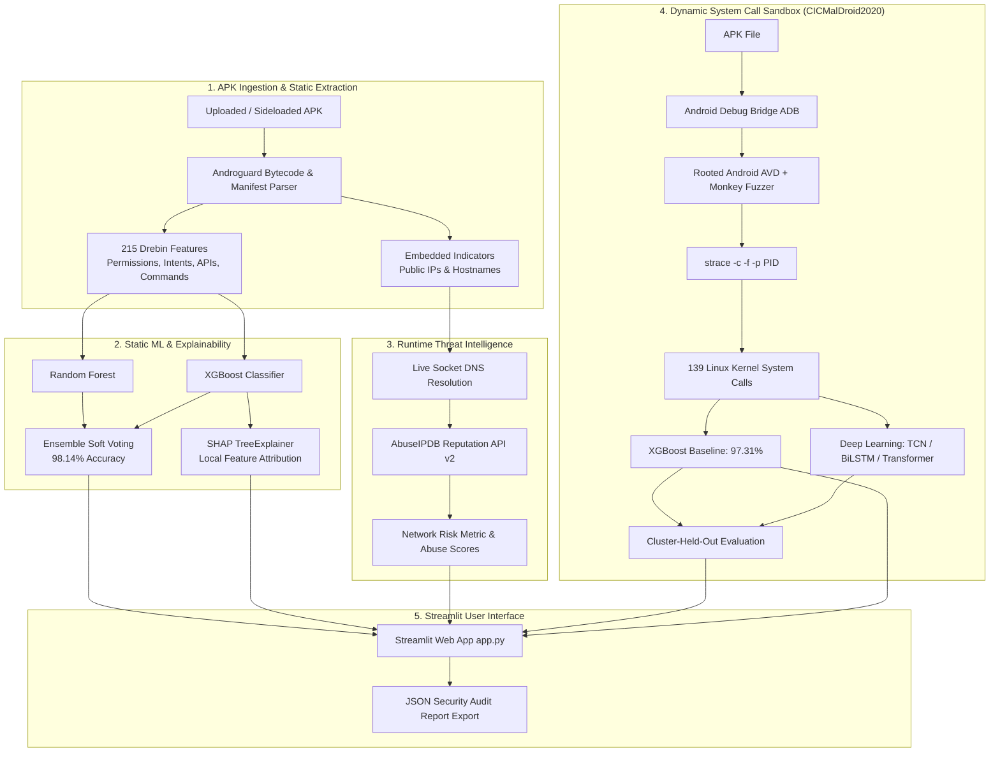

# AI-Based Detection of Malicious Sideloaded Android Applications Using Runtime Threat Intelligence

An end-to-end machine learning, deep learning, and cyber threat intelligence framework for detecting, analyzing, and explaining malicious sideloaded Android applications (APKs) through dual static and dynamic pipelines, local Explainable AI (SHAP), and live IP reputation intelligence.

---

## 📌 Project Overview

Sideloaded Android applications—installed outside official app stores like Google Play—bypass pre-deployment vetting mechanisms and pose critical security threats. Attackers routinely employ code obfuscation, reflection, dynamic payload loading, and anti-analysis evasion tactics that defeat traditional signature-based static antiviruses.

This project delivers a production-grade defense-in-depth architecture:

1. **Static Analysis Engine (Drebin-215)**: Decompiles the APK safely in-memory (manifest & DEX bytecode), extracts 215 binary permissions, intent filters, sensitive API calls, and suspicious shell commands, and evaluates them using Random Forest and XGBoost.
2. **Soft Voting Ensemble (98.14% Accuracy)**: Fuses probabilities across tree classifiers to minimize prediction variance and maximize detection robustness.
3. **Local Explainable AI (SHAP)**: Provides local interpretability for every analyzed APK using `shap.TreeExplainer`, detailing exact feature attributions pushing predictions toward benign or malware.
4. **Threat Intelligence Enrichment (AbuseIPDB)**: Extracts embedded public IP addresses and domains from application bytecode and cross-references them against live cyber threat intelligence feeds.
5. **Live Dynamic Sandbox Emulation (CICMalDroid2020 & strace)**: Automated runtime execution on a rooted Android emulator with UI monkey event fuzzing, capturing 139 Linux kernel system calls evaluated against deep learning models (TCN, BiLSTM, Transformer) and XGBoost.
6. **Interactive Streamlit Web Dashboard**: Production-grade web interface for uploading APKs, viewing real-time verdicts, inspecting interactive SHAP charts, triggering live dynamic ADB sandbox traces, and exporting SIEM-compliant JSON audit reports.

---

## 🏗️ System Architecture & Workflow

```
[ Uploaded APK File ]
         │
         ├───► STEP 1: APK Ingestion & Pre-Processing (Streamlit UI / CLI)
         │
         ├───► STEP 2: Safe Static Decompilation & Feature Extraction (Androguard 4.x)
         │        ├── Manifest: Declared Permissions & Intent Filters
         │        └── DEX Bytecode: API calls, method signatures & shell commands
         │        └── Result: 215-Dimensional Drebin binary feature vector
         │
         ├───► STEP 3: Runtime Threat Intelligence Subsystem (AbuseIPDB API v2)
         │        ├── Bytecode regex mining for public IPv4 addresses & domains
         │        ├── RFC 1918 private range filtering & live socket DNS resolution
         │        └── Abuse confidence score (0–100%) & C2 classification (>=50%)
         │
         ├───► STEP 4: Static ML Inference & Soft Voting Ensemble
         │        ├── Random Forest (100 trees, Gini impurity)
         │        ├── XGBoost Classifier (depth 6, log-loss)
         │        └── Fused Ensemble: P = 0.5 * (P_RF + P_XGB) -> 98.14% Test Accuracy
         │
         ├───► STEP 5: Local Explainable AI (SHAP TreeExplainer)
         │        └── Exact Shapley values identifying top malware-pushing vs benign-pushing features
         │
         ├───► STEP 6: Live Dynamic Sandbox Emulation (ADB + Android Emulator)
         │        ├── Injects APK via ADB to rooted Android Virtual Device (AVD, API 34)
         │        ├── Launches process & attaches: strace -c -f -p <PID>
         │        └── Fuzzes UI with random touch/gesture/key events via Monkey (30s default)
         │
         ├───► STEP 7: Dynamic Syscall Processing & ML Inference
         │        ├── Parses & normalizes 139 Linux kernel syscall frequencies
         │        └── Evaluates via Dynamic XGBoost (97.31%) & TCN Deep Learning models
         │
         └───► STEP 8: Presentation & Reporting Layer
                  ├── Malware / Benign Verdict Banner & Probability Score
                  ├── Interactive SHAP Contribution Bar Chart
                  ├── Threat Intelligence & IP Risk Table
                  └── Exportable JSON Security Audit Report (apk_analysis_report.json)
```



---

## 📊 Experimental Results & Benchmarks

### 1. Static Analysis (Drebin-215: 7,254 Unique Deduplicated Applications)
Evaluated on a 20% held-out test split ($N = 1,451$):

| Model Architecture | Accuracy | Precision | Recall (Malware) | F1-Score | ROC-AUC |
| :--- | :---: | :---: | :---: | :---: | :---: |
| **Random Forest** | 97.11% | 96.02% | 91.55% | 0.9373 | 0.9926 |
| **XGBoost** | 98.00% | 95.91% | **95.63%** | 0.9577 | **0.9961** |
| **Fused Ensemble (RF + XGB)** | **98.14%** | **96.75%** | 95.34% | **0.9604** | 0.9952 |

*5-Fold Stratified Cross-Validation:* Fused Ensemble achieves $97.63\% \pm 0.33\%$ accuracy and $0.9948 \pm 0.0012$ ROC-AUC.

### 2. Dynamic System-Call Analysis (CICMalDroid2020: 11,520 Applications)
Evaluated across 139 Linux system calls using both standard random splits and rigorous **Cluster-Held-Out cross-validation** (holding out entire malware families to prevent cross-family data leakage):

| Model Architecture | Random Test Acc | Random ROC | Cluster-Held-Out Acc | Cluster-Held-Out ROC |
| :--- | :---: | :---: | :---: | :---: |
| **XGBoost** | **97.31%** | **0.9915** | **91.99% ± 3.36%** | **0.9600 ± 0.0223** |
| **Transformer** | 90.93% | 0.9691 | 86.15% ± 6.62% | 0.9419 ± 0.0125 |
| **TCN (Multi-Branch)** | 94.53% | 0.9554 | 84.99% ± 3.14% | 0.9013 ± 0.0409 |
| **BiLSTM** | 90.80% | 0.9523 | 79.69% ± 9.25% | 0.8806 ± 0.0552 |

### 3. McNemar Statistical Significance
Pairwise McNemar hypothesis tests with Bonferroni correction ($\alpha = 0.05/3$) confirm that tabular XGBoost provides statistically significant superior generalization on system-call frequency vectors over sequence deep learning models ($p < 0.001$).

---

## 📁 Repository Structure

```text
├── app.py                                                # Main Streamlit web application interface
├── phase3_live_demo.py                                   # Static analysis engine, feature extractor & AbuseIPDB client
├── phase5_live_capture.py                                # Dynamic strace capture pipeline via ADB & Android emulator
├── requirements.txt                                      # Python dependencies
├── sample_app.apk                                        # Included sample APK for testing and demonstration
├── static.ipynb                                          # Static model training notebook (Drebin-215)
├── dynamic.ipynb                                         # Dynamic models training notebook (CICMalDroid2020)
├── threat_intellignece.ipynb                             # Threat intelligence exploration and validation notebook
├── generate_technical_doc.py                             # Automated technical documentation & PDF generator
├── PROJECT_TECHNICAL_SPECIFICATION.md                    # Comprehensive system architecture & technical specification
├── Android_Malware_Detection_Technical_Specification.pdf  # Generated technical specification (PDF)
├── Android_Malware_Detection_Technical_Specification.docx # Generated technical specification (Word DOCX)
├── static_outputs/                                       # Trained static model bundle, CSV metrics, and evaluation plots
│   ├── static_model.joblib                               # Serialized RF + XGBoost static models & scaler
│   ├── test_results.csv                                  # Held-out static test metrics
│   ├── cv_results.csv                                    # 5-fold cross-validation metrics
│   └── *.png                                             # Confusion matrices, ROC/PR curves, SHAP summary & bar plots
└── dynamic_outputs_v2/                                   # Trained dynamic models, weights, CSV metrics, and plots
    ├── dynamic_model.joblib                              # Serialized dynamic XGBoost model & feature mappings
    ├── tcn_weights.pt                                    # Trained PyTorch Multi-Branch TCN model weights
    ├── cv_results_cluster_heldout.csv                    # Cluster-held-out cross validation metrics
    ├── mcnemar_cluster_heldout.csv                       # McNemar statistical test results
    ├── feature_count_analysis.csv                        # Sensitivity analysis across feature subsets
    └── *.png                                             # Accuracy vs features, ROC/PR curves, SHAP summary
```

---

## ⚙️ Installation & Environment Setup

The system supports cross-platform execution on **Windows 11** and **Ubuntu on WSL 2**.

### Prerequisites
- Python 3.10+ (Tested on Python 3.12 and 3.13)
- Android Studio with Android SDK Platform Tools (`adb`)
- Android Virtual Device (AVD) running a **"Google APIs"** system image (API 34 recommended) with root enabled (`adb root`)

### Environment Setup

#### Option A: Ubuntu on WSL 2 (Recommended for Linux/WSL Development)
```bash
# Create and activate virtual environment
python3 -m venv ~/venvs/malware-phase5
source ~/venvs/malware-phase5/bin/activate

# Install dependencies
cd /mnt/c/Users/ASHWITH/Downloads/cis/malware
pip install -r requirements.txt
pip install reportlab python-docx
```

*Note for WSL 2 users accessing Windows ADB:* Ensure `~/bin/adb` wraps the Windows `adb.exe` executable:
```bash
mkdir -p ~/bin
cat << 'EOF' > ~/bin/adb
#!/bin/bash
/mnt/c/Users/$USER/AppData/Local/Android/Sdk/platform-tools/adb.exe "$@"
EOF
chmod +x ~/bin/adb
export PATH="$HOME/bin:$PATH"
```

#### Option B: Windows (PowerShell)
```powershell
# Create and activate virtual environment
python -m venv app_env
.\app_env\Scripts\Activate.ps1

# Install dependencies
pip install -r requirements.txt
pip install reportlab python-docx
```

---

## 🚀 Running the Application

### 1. Launch the Streamlit Web Application
Run the dashboard using Streamlit:

**Ubuntu on WSL 2:**
```bash
/home/ashwith/venvs/malware-phase5/bin/streamlit run app.py
```

**Windows PowerShell:**
```powershell
streamlit run app.py
```

Open your browser at `http://localhost:8501`.

#### Application Features:
- **Tab 1 — Analyze an APK**: Upload any `.apk` or use the bundled `sample_app.apk`. Provides:
  - High-visibility verdict banner (`BENIGN` vs. `MALWARE`) with calibrated confidence score.
  - Interactive horizontal SHAP attribution chart detailing exact positive/negative risk drivers.
  - Breakdown of detected permissions, intent filters, sensitive APIs, and shell commands.
  - Embedded public IP extraction and live AbuseIPDB threat intelligence audit.
  - Downloadable JSON audit report (`apk_analysis_report.json`) for SIEM/SOC integration.
- **Tab 2 — Static Model Results**: Interactive review of held-out test sets, 5-fold cross-validation metrics, confusion matrices, ROC/PR curves, and global SHAP importance.
- **Tab 3 — Dynamic Model Results**: Inspection of CICMalDroid2020 system-call benchmarks, cluster-held-out validation, McNemar statistical significance tests, and feature count sensitivity analysis.
- **Tab 4 — Live Dynamic ADB Emulation**: Integrated live sandbox execution directly in the browser:
  - Readiness check for ADB connectivity, emulator root status, and `strace` binary.
  - Execution duration slider (10 to 120 seconds).
  - Automated APK installation, Monkey UI fuzzing, kernel system call capture, and Dynamic XGBoost inference.
- **Tab 5 — System Architecture & Limitations**: Technical overview, dataset disclosures, and academic caveats.

---

### 2. Standalone Command-Line Static Demo
Execute static feature extraction and threat intelligence from the terminal:

```bash
python phase3_live_demo.py sample_app.apk
```

**Optional Arguments:**
- `--key <ABUSEIPDB_API_KEY>`: Query AbuseIPDB for reputation scores of embedded IPs.
- `--resolve`: Perform live DNS resolution of embedded hostnames to query resolved IPs.
- `--top <N>`: Display top $N$ SHAP evidence features (default: 8).

---

### 3. Standalone Dynamic Live Emulation Capture (Phase 5)
Run dynamic system call capture and prediction directly from the terminal:

1. Launch your Android Virtual Device (AVD) from Android Studio.
2. Verify ADB readiness and root privileges:
   ```bash
   python phase5_live_capture.py check
   ```
3. Run live capture and inference:
   ```bash
   python phase5_live_capture.py sample_app.apk 30
   ```
   *(Optional `--json-out <path>` flag exports structured JSON results).*

---

### 4. Regenerating Technical Documentation
To regenerate the comprehensive PDF, DOCX, and Markdown specifications:

```bash
python generate_technical_doc.py
```

Generates:
- `Android_Malware_Detection_Technical_Specification.pdf`
- `Android_Malware_Detection_Technical_Specification.docx`
- `PROJECT_TECHNICAL_SPECIFICATION.md`

---

## 🔑 Threat Intelligence (AbuseIPDB) Configuration

To enable live reputation lookups for embedded public IP addresses:
1. Register for a free API key at [AbuseIPDB](https://www.abuseipdb.com/).
2. Provide the API key via any of the following methods:
   - **Streamlit Sidebar**: Paste the key into the *AbuseIPDB API key* password field.
   - **Environment Variable**:
     ```bash
     export ABUSEIPDB_KEY="your_api_key_here"
     ```
     *(In Windows PowerShell: `$env:ABUSEIPDB_KEY="your_api_key_here"`)*
   - **CLI flag**: Pass `--key your_api_key_here` when running `phase3_live_demo.py`.

*Note: API keys are handled strictly in memory and are never written to disk, logged, or exported into audit JSON reports.*

---

## 🛡️ Safety & Research Disclosures

- **Static Safety**: The static analyzer only inspects the APK container (like reading a zip archive). The target APK is never installed or executed on the host system.
- **Dynamic Isolation**: Dynamic emulation executes applications strictly inside an isolated Android emulator sandbox. Never execute unverified APKs on physical production devices.
- **Academic Context**: Static models were trained on the Drebin-215 dataset; dynamic models were trained on CICMalDroid2020. Predictions provide probabilistic decision support and should be paired with human review.
