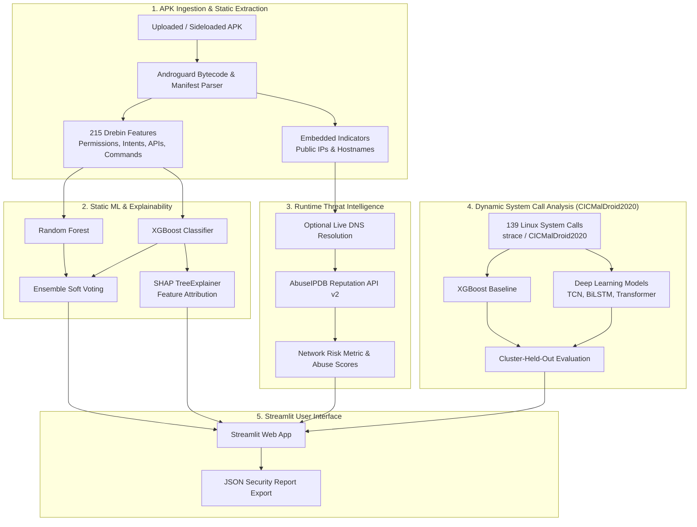

# AI-Based Detection of Malicious Sideloaded Android Applications Using Runtime Threat Intelligence

An end-to-end machine learning and threat intelligence framework for detecting and explaining malicious sideloaded Android applications (APKs) through dual static and dynamic pipelines, explainable AI (SHAP), and live IP reputation analysis.

---

## 📌 Project Overview

Sideloaded Android applications—installed outside official app stores like Google Play—bypass vetting mechanisms and pose significant security threats. This project implements a comprehensive defense-in-depth architecture:

1. **Static Analysis Pipeline (Drebin-215)**: Decompiles the APK safely (manifest & DEX bytecode), extracts 215 permissions, intents, API calls, and suspicious shell commands, and evaluates them with Random Forest and XGBoost classifiers.
2. **Explainable AI (SHAP)**: Provides local interpretability for every analyzed APK using TreeExplainer, showing exact feature attributions pushing predictions toward benign or malware.
3. **Threat Intelligence Enrichment (AbuseIPDB)**: Extracts embedded public IP addresses and domains from application bytecode and cross-references them against live cyber threat intelligence feeds.
4. **Dynamic System-Call Analysis (CICMalDroid2020)**: Benchmarks deep learning models (Temporal Convolutional Networks [TCN], BiLSTM, Transformer) alongside XGBoost on 139 Linux kernel system calls across 11,520 applications with rigorous cluster-held-out cross-validation.
5. **Interactive Streamlit Web Dashboard**: Provides a unified user interface for uploading APKs, viewing real-time verdicts, inspecting SHAP attribution charts, analyzing network risks, and reviewing benchmark experimental outputs.

---

## 🏗️ Architecture & Workflow



---

## 📊 Experimental Results & Benchmarks

### 1. Static Analysis (Drebin-215: 7,254 Unique Apps)
Evaluated on a held-out 20% test split:

| Model | Accuracy | Precision | Recall | F1-Score | ROC-AUC |
| :--- | :---: | :---: | :---: | :---: | :---: |
| **Random Forest** | 97.11% | 96.02% | 91.55% | 0.9373 | 0.9926 |
| **XGBoost** | 98.00% | 95.91% | 95.63% | 0.9577 | 0.9961 |
| **Fused Ensemble (RF + XGB)** | **98.14%** | **96.75%** | **95.34%** | **0.9604** | **0.9952** |

### 2. Dynamic System-Call Analysis (CICMalDroid2020: 11,520 Apps)
Tested across 139 system calls using random splits and cluster-held-out splits (conservative realistic evaluation):

| Model Architecture | Test Accuracy | Precision | Recall (Malware) | Specificity (Benign) | F1-Score | ROC-AUC |
| :--- | :---: | :---: | :---: | :---: | :---: | :---: |
| **XGBoost** | **97.31%** | **99.01%** | **97.79%** | **94.69%** | **0.9840** | **0.9915** |
| **TCN (Multi-Branch)** | 94.53% | 96.33% | 97.23% | 79.89% | 0.9678 | 0.9554 |
| **Transformer** | 90.93% | 97.96% | 91.16% | 89.66% | 0.9444 | 0.9691 |
| **BiLSTM** | 90.80% | 97.33% | 91.62% | 86.31% | 0.9439 | 0.9523 |

---

## 📁 Repository Structure

```text
├── app.py                      # Main Streamlit web application interface
├── phase3_live_demo.py         # Static analysis engine, feature extractor & AbuseIPDB client
├── phase5_live_capture.py      # Dynamic strace capture pipeline via ADB & Android emulator
├── requirements.txt            # Python dependencies
├── sample_app.apk              # Included sample APK for testing and demonstration
├── static.ipynb                # Static model training notebook (Drebin-215)
├── dynamic.ipynb               # Dynamic models training notebook (CICMalDroid2020)
├── threat_intellignece.ipynb   # Threat intelligence exploration and validation notebook
├── app_env/                    # Pre-configured Python virtual environment
├── static_outputs/             # Trained static model bundle, CSV metrics, and evaluation plots
│   ├── static_model.joblib
│   ├── test_results.csv
│   ├── cv_results.csv
│   └── *.png (Confusion matrices, ROC/PR, SHAP beeswarm & bar)
└── dynamic_outputs_v2/         # Trained dynamic models, weights, CSV metrics, and plots
    ├── dynamic_model.joblib
    ├── tcn_weights.pt
    ├── cv_results_cluster_heldout.csv
    ├── pooled_results_cluster_heldout.csv
    ├── feature_count_analysis.csv
    ├── mcnemar_cluster_heldout.csv
    └── *.png (Accuracy vs features, ROC/PR, SHAP summary)
```

---

## ⚙️ Installation & Environment Setup

The repository is pre-configured with a dedicated virtual environment named `app_env`.

### Prerequisites
- Python 3.10+ (Tested on Python 3.13)
- Windows / Linux / macOS
- (Optional) Android SDK Platform Tools (`adb`) for live emulator dynamic capture

### Activating the Environment

**Windows (PowerShell):**
```powershell
.\app_env\Scripts\Activate.ps1
```

**Windows (Command Prompt):**
```cmd
app_env\Scripts\activate.bat
```

**Linux / macOS:**
```bash
source app_env/bin/activate
```

*(Note: If configuring a new environment from scratch, install dependencies via `pip install -r requirements.txt`)*

---

## 🚀 Running the Application

### 1. Launch the Streamlit Web Application
Run the dashboard using the environment's Streamlit binary:

```powershell
.\app_env\Scripts\streamlit.exe run app.py
```
Open your browser and navigate to:
```
http://localhost:8501
```

#### Application Features:
- **Analyze an APK**: Upload any `.apk` file or click *"Use the included sample app"*. View:
  - Clean verdict banner (BENIGN vs. MALWARE) with probability score.
  - Interactive SHAP contribution horizontal bar chart explaining the verdict.
  - Detailed breakdown of detected permissions, intents, API calls, and commands.
  - Threat intelligence summary (embedded IPs, domains, and reputation lookups).
  - Downloadable JSON audit report (`apk_analysis_report.json`).
- **Static Model Results**: Interactive review of held-out test sets, 5-fold cross-validation metrics, confusion matrices, ROC/PR curves, and global SHAP importance.
- **Dynamic Model Results**: Inspection of CICMalDroid2020 system-call benchmarks, cluster-held-out validation, McNemar statistical significance tests, and feature count sensitivity analysis.
- **About and Limitations**: Academic transparency notes regarding dataset characteristics, feature approximations, and pipeline scope.

---

### 2. Command-Line Live Static Demo
You can execute the static feature extractor and live analysis script standalone:

```powershell
.\app_env\Scripts\python.exe phase3_live_demo.py sample_app.apk
```

**Optional Arguments:**
- `--key <ABUSEIPDB_API_KEY>`: Query AbuseIPDB for reputation scores of embedded IPs.
- `--resolve`: Perform live DNS resolution of embedded hostnames to test resolved IPs.
- `--top <N>`: Display top $N$ SHAP evidence features (default: 8).

---

### 3. Dynamic Live Emulation Capture (Phase 5)
To capture live system calls using an Android emulator and ADB:

1. Launch your Android Virtual Device (AVD) with root/debug privileges.
2. Verify ADB connectivity:
   ```powershell
   .\app_env\Scripts\python.exe -c "import phase5_live_capture; phase5_live_capture.check_setup()"
   ```
3. Run live dynamic capture and prediction:
   ```powershell
   .\app_env\Scripts\python.exe phase5_live_capture.py sample_app.apk
   ```

---

## 🔑 Threat Intelligence (AbuseIPDB) Configuration

To enable live reputation lookups for embedded public IP addresses:
1. Register for a free API key at [AbuseIPDB](https://www.abuseipdb.com/).
2. You can provide the API key in any of the following ways:
   - **Streamlit Sidebar**: Paste the key into the *AbuseIPDB API key* password field.
   - **Environment Variable**: Set `ABUSEIPDB_KEY` in your terminal:
     ```powershell
     $env:ABUSEIPDB_KEY="your_api_key_here"
     ```
   - **CLI flag**: Pass `--key your_api_key_here` when running `phase3_live_demo.py`.

*Note: Keys are used solely for direct in-memory API queries and are never logged, stored, or exported into report JSON files.*

---

## 🛡️ Safety & Research Notes

- **Static Safety**: The static analyzer only decompiles and inspects the APK package (analogous to reading a zip archive). The target APK is never installed or executed on the host machine.
- **Dynamic Isolation**: Dynamic emulation (Phase 5) executes applications inside an isolated Android emulator with automated monkey interactions and `strace`. Do not run untrusted or suspicious APKs on physical production devices.
- **Dataset Honesty**: Models were trained on public benchmarks (Drebin-215 and CICMalDroid2020). Predictions on novel live APKs approximate benchmark conditions and provide decision support rather than a single source of truth.
